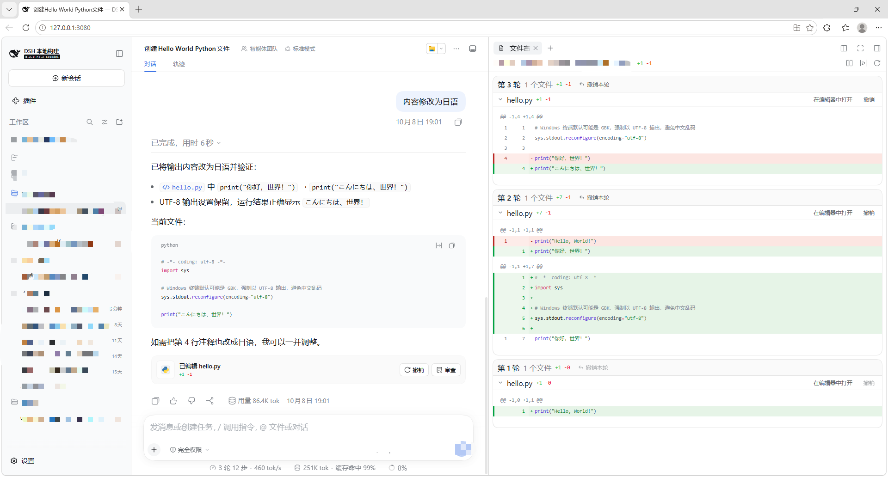

# dsh-file-review-tab

> **前置依赖**：DeepSeek Harness web（**0.2.0-rc.2+**，已在 0.2.0-rc.2 上真机验证）+ [dsh-better-sidebar](https://github.com/omdsh-dev/DSH-better-sidebar)（≥ 0.19.1，已在 0.24.1 上验证）。低版本 DSH 请按 [版本对应](#版本对应) 选择插件版本；**0.7.x 目前只存在于本仓库的 GitHub 源**，npm 与上游 `main` 仍停在 `0.5.0`，安装命令见 [安装](#安装)。
>
> **Requirements**: DeepSeek Harness web (**0.2.0-rc.2+**, verified on 0.2.0-rc.2) + [dsh-better-sidebar](https://github.com/omdsh-dev/DSH-better-sidebar) (≥ 0.19.1, verified on 0.24.1). Pick the plugin version per [version mapping](#版本对应); **0.7.x exists only in this repo's GitHub source** — npm and upstream `main` are still `0.5.0`. Install commands: [Install](#安装).

把 [dsh-file-review](https://github.com/left0ver/dsh-file-review)（作者 [left0ver](https://github.com/left0ver)）的"改动审查"能力移植为 [dsh-better-sidebar](https://github.com/omdsh-dev/DSH-better-sidebar) 的侧边栏 Tab，并保留对话尾部的审查行——两个入口同源，互不干扰。

> Port of [left0ver/dsh-file-review](https://github.com/left0ver/dsh-file-review)'s change-review capability into a [dsh-better-sidebar](https://github.com/omdsh-dev/DSH-better-sidebar) sidebar tab, keeping the chat turn-tail review row.

> **镜像说明**：本仓库（[whybebabo/dsh-file-review-tab](https://github.com/whybebabo/dsh-file-review-tab)）镜像自 [Lzh3070/dsh-file-review-tab](https://github.com/Lzh3070/dsh-file-review-tab)，保留其完整提交历史与插件名 `dsh-file-review-tab`（未改名）。注意：上游 `main` 与 npm 最新发布都停在 **`0.5.0`**（面向 DSH 0.1.5），本仓库在其之上还带有 0.6.0 / 0.7.0 的提交（面向 DSH 0.2.0，尚未合并回上游、也未发布 npm）——因此 **`0.7.0` 只能从本仓库的 GitHub 源安装**。上游若更新，请以 [Lzh3070/dsh-file-review-tab](https://github.com/Lzh3070/dsh-file-review-tab) 与 npm 为准。
>
> **Mirror notice**: this repository ([whybebabo/dsh-file-review-tab](https://github.com/whybebabo/dsh-file-review-tab)) mirrors [Lzh3070/dsh-file-review-tab](https://github.com/Lzh3070/dsh-file-review-tab) with the same commit history and the same plugin name (no rename). Note that upstream `main` and the latest npm release are both still **`0.5.0`** (DSH 0.1.5); this mirror additionally carries the 0.6.0 / 0.7.0 commits (DSH 0.2.0, not yet merged upstream nor published to npm), so **`0.7.0` can only be installed from this GitHub source**. Treat upstream and the npm package as canonical.

## 功能

- **对话尾部审查行（与原生同款外观）**：回合结束出现「已编辑 N 个文件 +M −K」卡片，其外观**逐像素对齐 DSH 内置的 ui-deliverables 改动卡片**——同一个 60px 头部、40px 文件类型图标块、13px 标题、悬停时 `+N −K` 让位给「在侧边栏预览」、等宽字体文件行、超过 4 行折叠为「全部 N 个文件」，并同样复用官方的 `FileTypeIcon` / `HoverCard` / 折叠箭头。差异只有一处：**头部右上角多出「撤销（撤销后可点「重新应用」）与「审查」两个按钮**——内置卡片标题栏没有任何插槽，所以本插件自渲染同款卡片以容纳这两个按钮。鼠标悬停 500ms 即弹出该文件的 diff 预览；点「审查」或单个文件名，**深链打开侧边栏 Tab，自动展开对应文件的 diff 并定位到该轮分组顶部**（不再弹全宽 drawer）。
- **侧边栏 Tab「文件审查」**：按轮次分组列出本会话改动文件；点击展开行级红绿 diff；支持撤销本轮 / 单文件撤销 / 重新应用；Tab 角标实时显示改动文件数。
- **删除文件可见**：dsh 没有删除文件的工具，删除发生在终端命令里——插件解析 `rm` 族命令（`rm` / `rmdir` / `unlink` / `Remove-Item` / `del` / `rd` 等）的字面路径参数，被删文件以「已删除」标记出现在两个入口（内容已不存在，故无行级 diff、不可撤销）。带通配符（`rm *.log`）或命令替换（`rm $(...)`）的删除不识别——受影响文件事后无法枚举。
- **自动归档**：主列表只保留最近 5 轮（进行中的轮次永不归档），更早的已完成轮次沉入底部「已归档 N 轮」折叠区。折叠时归档内容零渲染，展开后每页加载 10 轮（「加载更多」续页），diff 行另有懒挂载——长会话不再一次性挂载几十个 diff 组。深链跳到已归档轮次会自动展开并定位；展开状态按会话记忆；角标只统计主列表。
- **PTC / Code Mode 支持**：`run_code` 程序内部的 `edit`/`write` 子调用也会被捕获——Host 端快照完整 before/after，浏览器端重建带行号的行级 hunks 并入所属轮次；diff 查看、状态检查、撤销/重做均可用。标准模式行为不变（对话尾部审查行仍只覆盖标准模式轮次）。
- **会话隔离**：每个会话只看自己的改动；Tab 不可见时暂停状态巡检。
- **窄容器自适应**：工作台横向分屏半宽或浮动独立窗口下，轮次头部自动换行、次要信息（行数统计、「在编辑器中打开」）让位，撤销操作与文件名始终完整。
- **样式隔离**：全部 CSS Module + 宿主 `--dsw-alias-*` 主题令牌，不与对话区或其他插件冲突。



## 安装

```sh
# 0.7.0 的唯一来源：本仓库的 GitHub 源
dsh plugin --profile web add github:whybebabo/dsh-file-review-tab

# 需要旧版（DSH 0.1.5）时才用 npm：npm 上没有 0.6.x / 0.7.x
dsh plugin --profile web add dsh-file-review-tab@0.5.0

# 不要这样装：Lzh3070/dsh-file-review-tab 的 main 仍是 0.5.0，装不到 0.7.0
# dsh plugin --profile web add github:Lzh3070/dsh-file-review-tab
```

`dsh plugin` 会把参数转发给 profile 目录下的 pnpm，所以 `github:owner/repo` 这类 pnpm 支持的源都可用；包名 `dsh-file-review-tab` 会解析到 npm 的 `0.5.0`。

装好后**重启 `dsh web`**，在 better-sidebar 侧边栏「+」菜单打开「文件审查」即可。`dsh-better-sidebar` 是前置依赖、不会随本插件自动装上，需另行安装（`dsh plugin --profile web add dsh-better-sidebar`）。

### 版本对应

`dsh-file-review-tab@0.7.x` 面向 DSH 0.2.0（服务端严格的 `TypertCodec.create()` 工厂 + `conversation.chat.turnTail` 加法列表槽 + 原生同款改动卡片）；`0.6.x` 为同一 DSH 0.2.0 但尾部为自定义卡片；仍停留在 DSH 0.1.5 的用户请继续使用 npm 上的 `dsh-file-review-tab@0.5.x`，0.1.2 / 0.1.1 请用 `0.4.1`。0.6.x / 0.7.x 尚未发布到 npm，只能从本仓库 GitHub 源安装。

## 致谢

核心 diff 渲染器与撤销服务移植自 [left0ver/dsh-file-review](https://github.com/left0ver/dsh-file-review)（MIT License, © ZhangWenChao）。侧边栏集成基于 [dsh-better-sidebar](https://github.com/omdsh-dev/DSH-better-sidebar) 开放的 `ctx.betterSidebar` 注册 API。

## License

[MIT](./LICENSE)

---

## Features (English)

- Chat turn-tail review row that mirrors the built-in ui-deliverables changes card (same 60px header, file-type tile, hover preview, 4-row fold with "All N files") and adds the two buttons the built-in header cannot host: undo/reapply and review. It deep-links into the sidebar tab (auto-expanding the diffs and scrolling the turn group to the top) instead of a full-width drawer.
- Sidebar tab "File Review" in dsh-better-sidebar: per-turn grouped changed files, line-level red/green diffs, undo per turn or per file, live badge with the changed-file count.
- Deleted files stay visible: dsh has no delete-file tool, so deletions happen in terminal commands — literal `rm`-family arguments (`rm`, `rmdir`, `unlink`, `Remove-Item`, `del`, …) are parsed and deleted files appear marked "deleted" in both surfaces (no line diff, no undo: the content is gone). Glob/command-substitution deletions are not guessed.
- Auto-archive: only the newest 5 turns stay in the main list (live turns never archive); older completed turns sink into an "Archived turns" section pinned to the tab's bottom. Collapsed it renders nothing; open, it loads 10 turns per page. Deep links auto-open and page to their target; the badge counts the main list only.
- Session-isolated, pause-when-hidden, CSS-Module scoped styling (no conflicts with the chat area or other plugins).
- Narrow-pane adaptive: in half-width splits and floated free windows the turn header wraps and secondary content yields so undo and file names never clip.

Requires DeepSeek Harness web (0.2.0-rc.2+, verified on 0.2.0-rc.2) and dsh-better-sidebar (≥ 0.19.1, verified on 0.24.1), the latter installed separately. `dsh-file-review-tab@0.7.x` targets the DSH 0.2.0 client API (strict `TypertCodec.create()`, additive `turnTail` list slot, native-identical changes card); 0.6.x targets the same DSH with a custom card. Neither 0.6.x nor 0.7.x is on npm — install them only from this repo's GitHub source (`dsh plugin --profile web add github:whybebabo/dsh-file-review-tab`); npm's latest is 0.5.0 for DSH 0.1.5, and 0.1.2 / 0.1.1 should use 0.4.1. Restart `dsh web` after installing, then open the "File Review" tab from the sidebar's "+" menu.

## Development

```sh
pnpm install
pnpm typecheck   # tsc --noEmit
pnpm build       # emits lib/ (host ESM + browser bundle + .d.ts)
pnpm test        # runtime checks; run after build
```

`pnpm test` drives the built artifacts through the real DSH 0.2.0 registries rather than mocking them, so a breaking upstream API change fails here instead of in the UI: `test/typert-descriptors.mjs` registers the Host Typert contribution and round-trips every codec (plus a control proving the pre-0.2.0 `schema:` codec shape is rejected), `test/slot-registration.mjs` registers the turn-tail entry against the real `SlotCore` (a list slot requires an `id`), `test/host-apply.mjs` runs the host half's `apply()` on a real cordis `Context` and drives the `tools/post-execute` recorder, and `test/client-bundle.mjs` evaluates `lib/client.js` the way the Web plugin loader does.
